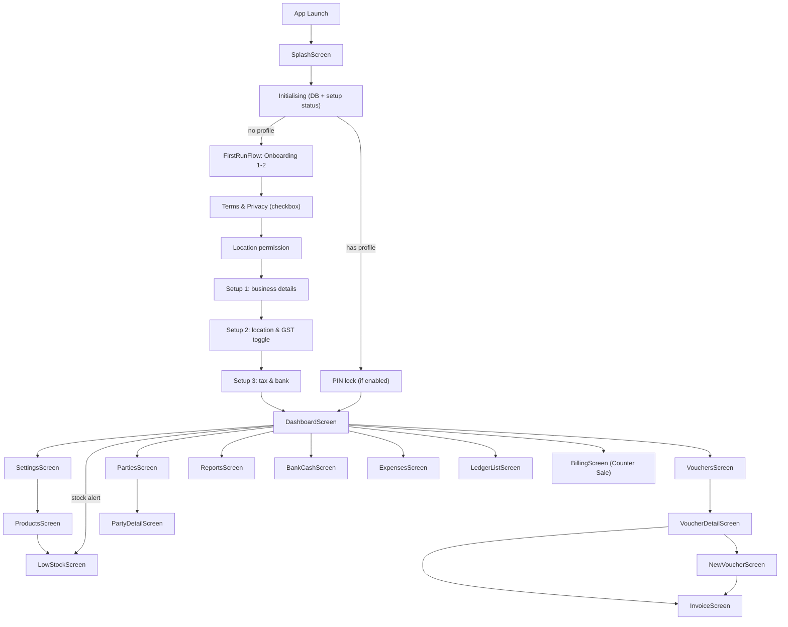

# SCREENS.md — Mavo

> Last updated: 2026-11-02

All screens share the graph-paper canvas. Content surfaces stay opaque for
readability. Theme selection offers four light accents (Zero, Saffron, Slate,
Ledger); saved Night and legacy Ink preferences resolve to Zero.

## Navigation structure

```
App Launch
  ├─ SplashScreen (Mavo wordmark on shared graph-paper canvas)
  ├─ Initialising (database progress and retry states on shared canvas)
  ├─ (no profile) → FirstRunFlow wizard
  │     Onboarding 1 → Onboarding 2 (pager dots, pill Next)
  │       → Terms & Privacy page (checkbox + document rows) → Location permission
  │       → Setup 1 "Basic details" → Setup 2 "Where you are" → Setup 3 "Tax & bank"
  │       → Dashboard
  └─ (has profile) → PIN (if enabled) → Dashboard
```

The wizard is not a NavHost route: it is the same `when` gate in `MainActivity.kt`
that used to show `SetupScreen`, so system Back only walks wizard steps.

### Adaptive top-level navigation

| Window | Navigation | Destinations |
|--------|------------|-------------|
| Compact | Material 3 bottom bar | Home, Vouchers, Parties, More, New Sale |
| Medium / expanded | Material 3 rail | Home, Vouchers, Parties, More; New Sale FAB |

More keeps the existing `settings` route and exposes Products, Reports, Ledger,
Bank & Cash, Expenses, and Settings. New Sale opens the existing voucher flow.
The shell is hidden during onboarding, PIN entry, and full-screen entry flows.

### Full screen map

Each root screen file serves as a thin router delegating by window size to either `mobile/Mobile<Screen>.kt` or `tablet/Tablet<Screen>.kt`, sharing types in `common/`.

| Screen router file | Mobile implementation | Tablet implementation | Route | Purpose | Entry from | Exit to |
|-------------|-------|---------|------------|---------|---|---|
| `SplashScreen.kt` | `mobile/MobileSplashScreen.kt` | `tablet/TabletSplashScreen.kt` | (initial) | Mavo splash on shared graph-paper canvas | App launch | Initialising, Setup or Dashboard |
| `DashboardScreen.kt` | `mobile/MobileDashboardScreen.kt` | `tablet/TabletDashboardScreen.kt` | `dashboard` | Action-first daily workspace with cached totals, responsive bento metrics, loading/retry states, stock alerts, recent activity | Adaptive Home destination | Any feature screen |
| `VouchersScreen.kt` | `mobile/MobileVouchersScreen.kt` | `tablet/TabletVouchersScreen.kt` | `vouchers` | Cached voucher list with loading/error/retry states, status/type filters, search, multi-select, export/delete | Adaptive Vouchers destination | VoucherDetail, NewVoucher |
| `PartiesScreen.kt` | `mobile/MobilePartiesScreen.kt` | `tablet/TabletPartiesScreen.kt` | `parties` | Cached customer/supplier list with loading/error/retry states, CRUD | Adaptive Parties destination | PartyDetail |
| `SettingsScreen.kt` | `mobile/MobileSettingsScreen.kt` | `tablet/TabletSettingsScreen.kt` | `settings` | More hub for Products, Reports, Ledger, Bank & Cash, Expenses, and Settings | Adaptive More destination | Sub-sections inline |
| `ProductsScreen.kt` | `mobile/MobileProductsScreen.kt` | `tablet/TabletProductsScreen.kt` | `products` | Cached catalog with loading/error/retry states, CRUD, stock info | Settings → Products | LowStock, back |
| `ReportsScreen.kt` | `mobile/MobileReportsScreen.kt` | `tablet/TabletReportsScreen.kt` | `reports` | Reports hub, trial balance, P&L, balance sheet, aged & payable bills | Settings → Reports | back |
| `BankCashScreen.kt` | `mobile/MobileBankCashScreen.kt` | `tablet/TabletBankCashScreen.kt` | `bank_cash` | Cash and bank ledger view and entry | Settings → Bank & Cash | back |
| `LedgerScreens.kt` | `mobile/MobileLedgerScreens.kt` | `tablet/TabletLedgerScreens.kt` | `expenses` | Expense and income ledger tracking | Settings → Expenses | back |
| `InvoiceScreen.kt` | `mobile/MobileInvoiceScreen.kt` | `tablet/TabletInvoiceScreen.kt` | `invoice/{voucherId}` | Printable invoice preview, thermal print & PDF share | Vouchers, NewVoucher | back |
| `ReportsScreen.kt` | `reports` | FY-scoped business and financial reports; cached reads with loading/error/retry states; expanded report menu and detail panes | Dashboard quick action | Back to Dashboard |
| `StockReportScreen.kt` | (inline in Reports, NewVoucher stock sheet) | Stock Summary: SKU / stock value / low-out stat cards, search toggle, All/Low/Out chips, status pills, CSV export | ReportsScreen, NewVoucher | ReportsScreen |
| `LowStockScreen.kt` | `lowstock` | "Inventory alerts": Low & Out of Stock list with Reorder pills; Dismiss / Create purchase order → Purchase voucher | Products banner, Dashboard stock alert | NewVoucher, back |
| `HsnSearchDialog.kt` | (dialog overlay) | Search HSN/SAC: keyword search, tappable results, Use-code confirm | Products editor, Quick-add product | Caller screen |
| `BankCashScreen.kt` | `bank_cash` | Width-constrained cash/bank register with cached loading/error/retry states and FY-scoped balances | Dashboard quick action | Back to Dashboard |
| `ExpensesScreen.kt` | `expenses` | Cached expense register with loading/error/retry states, category filters, CSV export, and entry form | Dashboard quick action | Back to Dashboard |
| `IncomeScreen.kt` | (inline) | Cached income register with loading/error/retry states, category filters, CSV export, and entry form | Dashboard quick action | Back to Dashboard |
| `LedgerListScreen.kt` | `ledger_books` | Width-constrained chart of accounts and FY-scoped balances with cached loading/error/retry states | Dashboard quick action | Back to Dashboard |
| `BillingScreen.kt` | `counter_sale` | Material 3 counter sale; search and sticky checkout stack on compact/medium windows, expanded windows show independent product and cart panes; product/party reads expose loading/error/retry states | Dashboard quick action | Back to Dashboard |
| `NewVoucherScreen` | `new_voucher?voucherId={id}` | Create voucher of any type via the 3-step phone wizard (Details → Items → Review); includes Journal DR/CR lines and Income/Expense category + payment account; Save Draft is available before posting; edit mode is a single page labelled "EDITING" | VoucherDetail, VouchersScreen, Dashboard | Invoice, back |
| `VoucherItemSheet.kt` | (bottom sheet in NewVoucher) | Add/edit line item on a voucher | NewVoucherScreen | NewVoucherScreen |
| `VoucherDetailScreen.kt` | `voucher_detail/{voucherId}` | Voucher summary: totals, line items, status pill, Edit / Share / PDF / Print bar, overflow Delete | VouchersScreen (row tap) | NewVoucher, InvoiceScreen, back |
| `VoucherDeleteSheet.kt` | (bottom sheet) | Delete confirm: voucher count, ledger entries reversed, total value, Cancel / Delete | VouchersScreen, VoucherDetailScreen | Caller screen |
| `InvoiceScreen.kt` | `invoice/{voucherId}` | View generated invoice, share/print | NewVoucher (after save), VoucherDetail | Back to Vouchers |
| `PartyDetailScreen` | `party_detail/{partyId}` | Party ledger, transaction history | PartiesScreen | Back to Parties |
| `BarcodeScannerDialog.kt` | (dialog overlay) | Camera barcode/OCR scanning | Products, NewVoucher | Caller screen |
| `BusinessProfileSettingsSection.kt` | (inline in Settings) | "Master data" modal: identity block + all profile fields (ZbField labels) + pinned Cancel / Save profile bar | SettingsScreen | SettingsScreen |
| `DataManagementContent` / `AuditLogContent` | (inline in Settings) | Backup/restore/CSV export-import, DB stats, FY audit events | Settings → Data Management | Settings |
| `EmailAutomationSection.kt` | (inline in Settings) | Email rules, accounts, history | SettingsScreen | SettingsScreen |
| `ProfileFormSupport.kt` | (shared form helpers) | Validation, `SetupStep` order, state auto-detect | First-run wizard, Settings | — |
| `SharedComponents.kt` | (shared) | `RetailTextField`, `StateDropdownMenu`, `WizardScaffold`, PIN lookup | Multiple screens | — |
| `ProductOptionalFields.kt` | (inline in Products) | Batch, serial, secondary unit fields | ProductsScreen | ProductsScreen |

## Navigation flow diagram



### Mavo · Redesign (Penpot design artifacts)

A premium Material 3 Expressive redesign of all 36 retail POS/accounting screens was built as Penpot-only design artifacts (no code changes). Original **Mavo UI mockups** boards are preserved intact; the redesign lives on new pages.

| Page | Purpose |
|------|---------|
| **Mavo · Redesign** | All 36 screens, 6 boards per row, 40 px gaps |
| **Mavo · System** | Foundations + component sheet (palette, type, components, motion, layout rules) |

**Board grid:** 390 × 844 boards, rows y = 0, 900, 1800, 2700, 3600, 4500. Original boards must not be deleted or overwritten.

| Row | y | Screens |
|-----|-----|---------|
| 1 | 0 | 01 · Home / Dashboard, 02 · Vouchers, 03 · Parties, 04 · More / Settings, 05 · Counter Sale, 06 · Voucher Detail |
| 2 | 900 | 07 · Splash, 08 · Initialising, 09 · Database Error, 10 · Onboarding 1, 11 · Onboarding 2, 12 · Terms & Privacy |
| 3 | 1800 | 13 · Location Permission, 14 · Setup 1 · Basic details, 15 · Setup 2 · Where you are, 16 · Setup 3 · Tax & bank, 17 · Sample Data Prompt, 18 · PIN Lock |
| 4 | 2700 | 19 · Products, 20 · Product Editor, 21 · Low Stock, 22 · Reports Hub, 23 · Trial Balance, 24 · Stock Report |
| 5 | 3600 | 25 · Bank & Cash, 26 · Expenses, 27 · Expense Entry, 28 · Ledger Books, 29 · Party Detail, 30 · Add Party |
| 6 | 4500 | 31 · New Voucher · Details, 32 · New Voucher · Line items, 33 · New Voucher · Review, 34 · Invoice, 35 · Profit & Loss, 36 · GST Summary |

**Shared chrome on every screen:** status bar, header (eyebrow + title + optional back/action icons), content area, floating dock (Home / Vouchers / Parties / More + New Sale FAB), thin home indicator. Helpers live in `lib2.js` (Penpot plugin context): `status`, `header`, `section`, `card`, `btn`, `chip`, `field`, `avatar`, `divider`, `metric`, `listRow`, `dock`, `segmented`, `searchbar`, `tabs`, `sheet`, `logo`, `grid`, `bars`, `empty`.

**Home board id:** `6e51fff9-1717-80b9-8008-df7cd5b2b9d8` (01 · Home / Dashboard).

